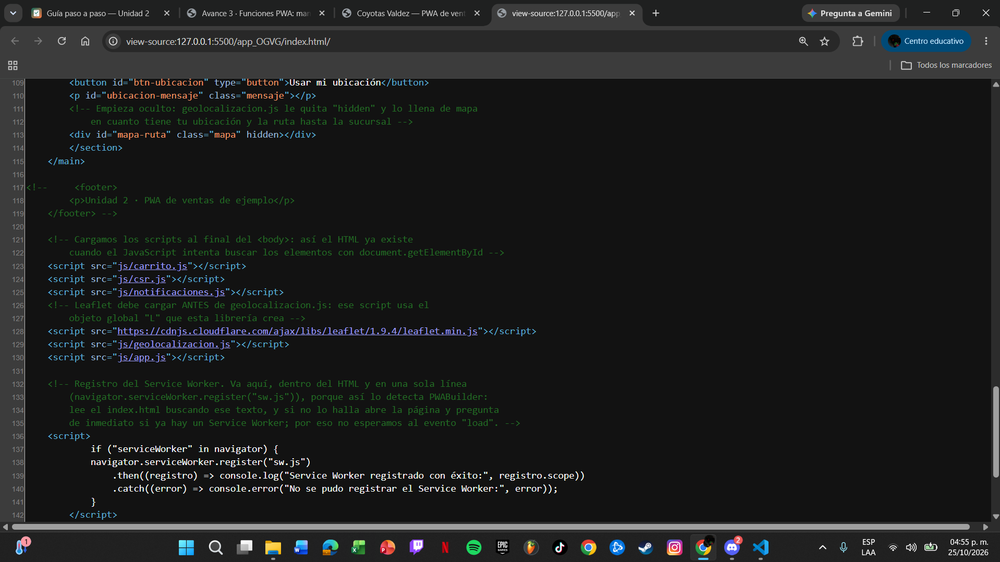
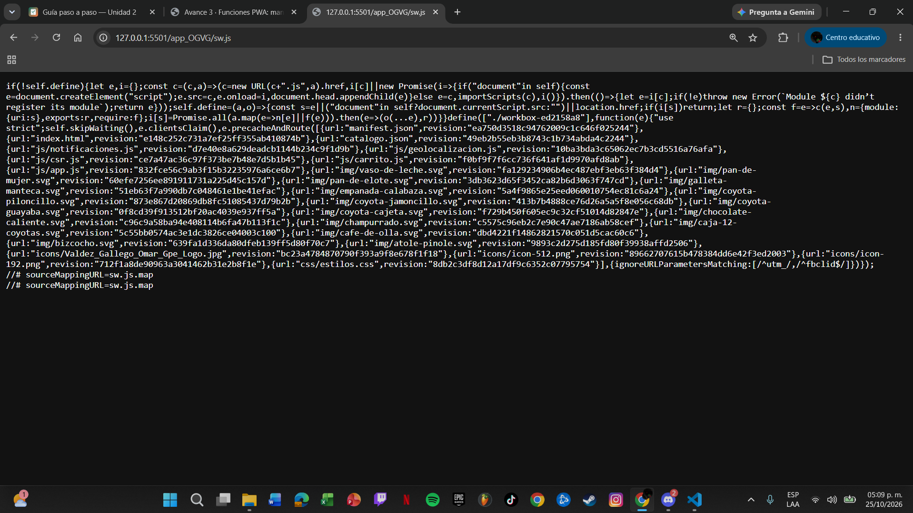
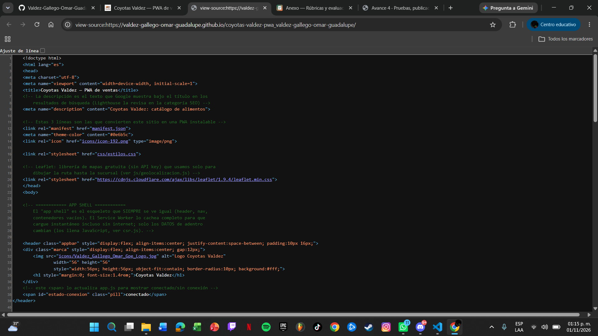
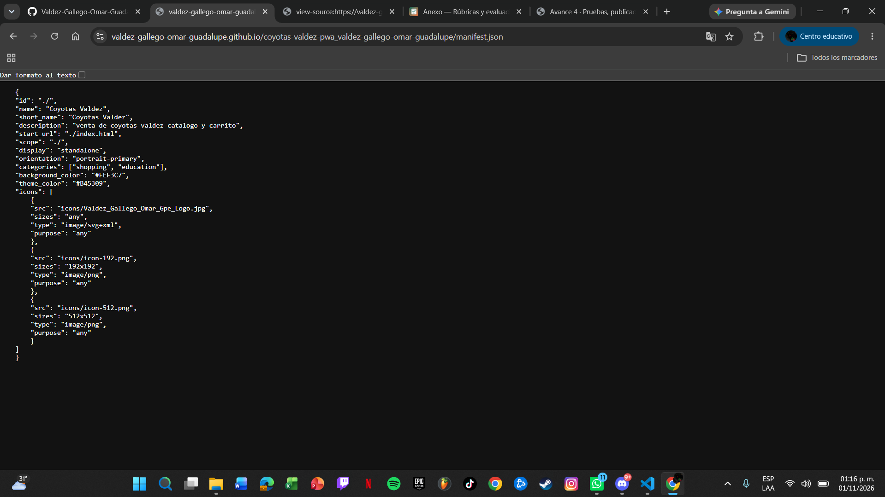
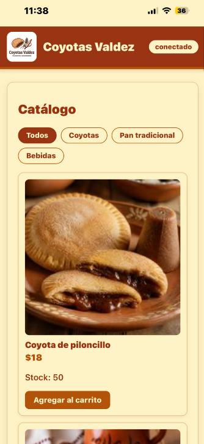

# Nombre de tu negocio — PWA de ventas

| Dato | Valor |
|---|---|
| **Alumno** | Valdez Gallego Omar Guadalupe |
| **Grupo** | ING 10-1 |
| **Negocio · giro** | Coyotas Valdez · Panadería sonorense |
| **URL del repositorio** | https://github.com/Valdez-Gallego-Omar-Guadalupe/coyotas-valdez-pwa_valdez-gallego-omar-guadalupe.git|

| **URL de GitHub Pages** | https://valdez-gallego-omar-guadalupe.github.io/coyotas-valdez-pwa_valdez-gallego-omar-guadalupe/ |

## Historial de avances

| Avance | Hash del commit entregado | Fecha |
|---|---|---|
| 1 | (4f87e94) | 11/10/2026 |
| 2 | (866e13e) | 18/10/2026 |
| 3 | (65ddbdf) | 25/10/2026 |
| 4 | (se escribe en el reporte PDF) | 01/11/2026 |

## Comparación SSR vs CSR

### SSR (Django): los productos llegan escritos en el HTML

### CSR (JavaScript): el div del catálogo llega vacío

## Funciones PWA (avance 3)

### index.html: manifest y registro del Service Worker activos

### sw.js: Workbox precachea el catálogo y las fotos

## Versión publicada (avance 4)

### index.html en GitHub Pages

### manifest.json en GitHub Pages

### Mi app instalada en el celular

## Instalación de la aplicación

La app es una PWA: no se descarga de una tienda, se instala desde el navegador abriendo la URL de GitHub Pages:
https://valdez-gallego-omar-guadalupe.github.io/coyotas-valdez-pwa_valdez-gallego-omar-guadalupe/

### Android (Chrome)

1. Abre la URL en **Google Chrome**.
2. Espera a que cargue por completo el catálogo.
3. Toca el menú **⋮** (arriba a la derecha).
4. Elige **Instalar aplicación** (o **Agregar a la pantalla principal**).
5. Confirma con **Instalar**.
6. El ícono de Coyotas Valdez aparece en la pantalla de inicio y en el cajón de apps; se abre en pantalla completa, sin barra del navegador.

> También puede aparecer un aviso automático en la parte inferior con el botón **Instalar**.

### iPhone (Safari)

1. Abre la URL en **Safari** (en iOS la instalación solo funciona desde Safari, o desde iOS 16.4 también en Chrome/Edge con el mismo botón Compartir).
2. Toca el botón **Compartir** (cuadro con flecha hacia arriba) en la barra inferior.
3. Desliza hacia abajo y elige **Agregar a pantalla de inicio**.
4. Revisa el nombre y toca **Agregar** (arriba a la derecha).
5. El ícono aparece en la pantalla de inicio; al abrirlo funciona como app independiente.

### Uso sin conexión

Después de abrir la app una vez con internet, el Service Worker guarda el catálogo y las fotos, así que se puede consultar aunque no haya conexión.

