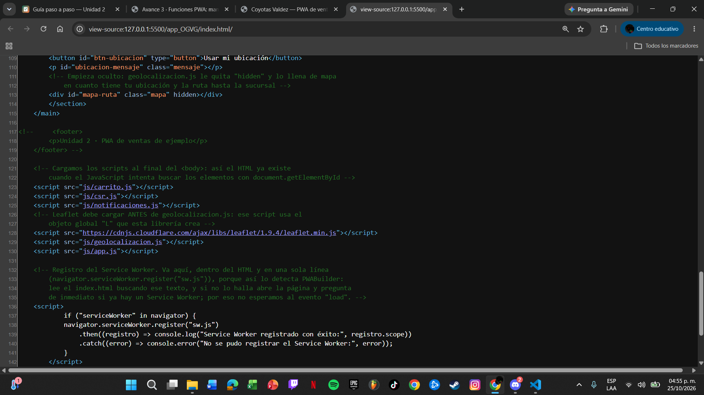
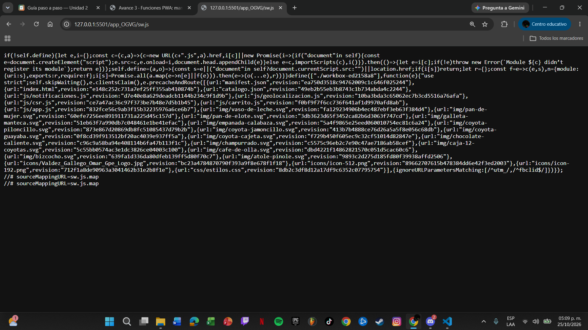

# Nombre de tu negocio — PWA de ventas

| Dato | Valor |
|---|---|
| **Alumno** | Valdez Gallego Omar Guadalupe |
| **Grupo** | ING 10-1 |
| **Negocio · giro** | Coyotas Valdez · Panadería sonorense |
| **URL del repositorio** | https://github.com/Valdez-Gallego-Omar-Guadalupe/coyotas-valdez-pwa_valdez-gallego-omar-guadalupe.git|

| **URL de GitHub Pages** | https://valdez-gallego-omar-guadalupe.github.io/coyotas-valdez-pwa_valdez-gallego-omar-guadalupe/ |

## Historial de avances

| Avance | Hash del commit entregado | Fecha |
|---|---|---|
| 1 | (4f87e94) | 11/10/2026 |
| 2 | (866e13e) | 18/10/2026 |
| 3 | (686b830) | 25/10/2026 |
| 4 | (se escribe en el reporte PDF) | 01/11/2026 |

## Comparación SSR vs CSR

### SSR (Django): los productos llegan escritos en el HTML

### CSR (JavaScript): el div del catálogo llega vacío

## Funciones PWA (avance 3)

### index.html: manifest y registro del Service Worker activos

### sw.js: Workbox precachea el catálogo y las fotos
